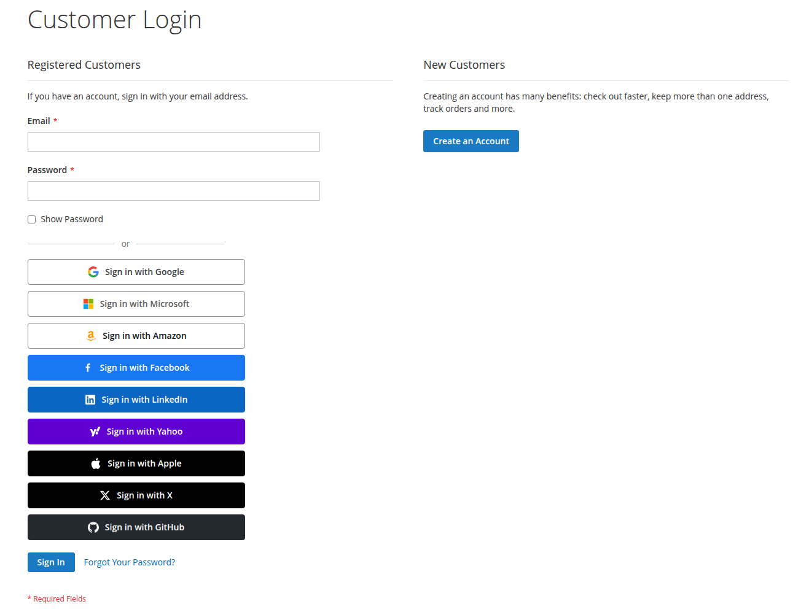
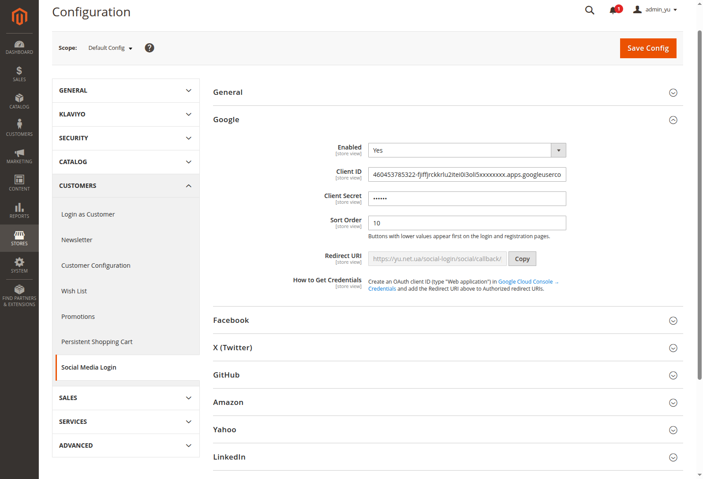
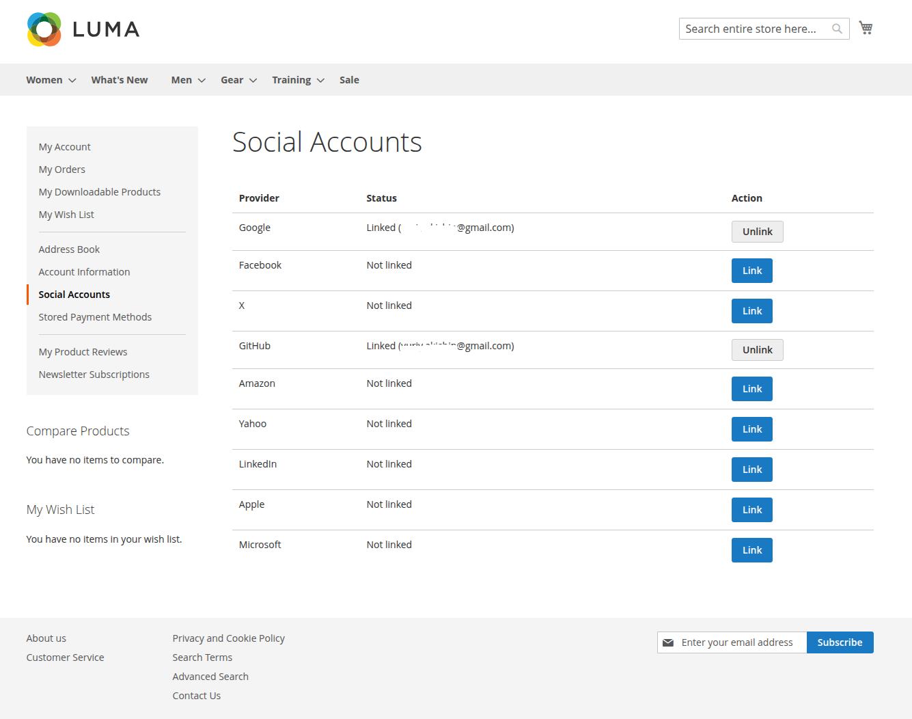

# Magento 2 Social Login

<a href="https://yu.net.ua/customer/account/login/" target="_blank" rel="noopener noreferrer"></a>

**🔗 Demo: <a href="https://yu.net.ua/customer/account/login/" target="_blank" rel="noopener noreferrer">yu.net.ua</a>**

Free, open-source Magento 2 extension: customers sign in and register with
Google, Facebook, Apple, X (Twitter), GitHub, LinkedIn, Microsoft, Amazon or
Yahoo. Built on top of [HybridAuth](https://hybridauth.github.io/), which
handles the OAuth protocol work (redirects, token exchange, CSRF `state`
validation), so the module stays small and focused on Magento integration.



## Supported providers

| Provider | Credentials | Notes |
|---|---|---|
| Google | Client ID / Client Secret | Email is always provided · [Get credentials](https://console.cloud.google.com/apis/credentials) |
| Facebook | App ID / App Secret | App must pass Facebook review for public use; accounts registered by phone may come without email · [Get credentials](https://developers.facebook.com/apps/) |
| X (Twitter) | Client ID / Client Secret | Enable "Request email from users" in the app settings, otherwise users are asked for their email · [Get credentials](https://developer.x.com/en/portal/dashboard) |
| GitHub | Client ID / Client Secret | Private emails are fetched via a separate API endpoint · [Get credentials](https://github.com/settings/developers) |
| Amazon | Client ID / Client Secret | [Get credentials](https://developer.amazon.com/loginwithamazon/console/site/lwa/overview.html) |
| Yahoo | Client ID / Client Secret | Needs OpenID Connect / Profile / Email permissions · [Get credentials](https://developer.yahoo.com/apps/) |
| LinkedIn | Client ID / Client Secret | Uses "Sign In with LinkedIn using OpenID Connect" (the modern product) · [Get credentials](https://www.linkedin.com/developers/apps) |
| Apple | Services ID / Team ID / Key ID / Private Key (.p8) | Requires a paid Apple Developer account; the private key is stored encrypted · [Get credentials](https://developer.apple.com/account/) |
| Microsoft | Application (client) ID / Client Secret | Register the app in Microsoft Entra ID → App registrations, for "any organizational directory and personal Microsoft accounts" · [Get credentials](https://portal.azure.com/) |

Every provider is independent: enable only the ones you need. The
"Get credentials" link in each row opens the developer console where you
register the app.

**Not supported:** Instagram (Meta shut down the Basic Display API in December
2024 — consumer "Login with Instagram" no longer exists), VK (no HybridAuth 3.x
adapter), Telegram (uses a Login Widget instead of OAuth — planned as a
separate feature).

## Requirements

- PHP >= 8.1
- Magento 2.4.x (declarative schema is used, so 2.4+ only)
- `hybridauth/hybridauth` ^3.0

## Installation

```bash
composer require yu-dev/module-social-login
bin/magento module:enable Yu_SocialLogin
bin/magento setup:upgrade
bin/magento setup:di:compile
bin/magento cache:flush
```

The `hybridauth/hybridauth` library is a composer dependency of the module and
is installed automatically.

<details>
<summary>Manual installation (without composer)</summary>

Copy the module to `app/code/Yu/SocialLogin` and install the OAuth library
yourself — with a manual copy, composer does not know about the module's
dependencies:

```bash
composer require hybridauth/hybridauth:^3.0
```

Then run the same `bin/magento` commands as above.
</details>

The module ships disabled by default — nothing appears on the storefront until
you enable it in the admin, so it is safe to deploy first and configure later.

## Configuration

**Stores → Configuration → Customers → Social Media Login**



- **General → Enabled** — master switch on top of the per-provider switches.
- Per provider:
  - **Enabled** — the button appears only when the provider is enabled *and*
    its credentials are filled in.
  - **Credentials** — see the table above; secrets are stored encrypted with
    Magento's standard config encryption.
  - **Sort Order** — buttons with lower values appear first on the login and
    registration pages.
  - **Redirect URI** — read-only field with a Copy button. Paste this exact
    value into the provider's developer console (authorized redirect / callback
    URL). It is generated from your store's base URL, so it is always correct
    for the scope you are editing.

Console links for every provider are in the
[Supported providers](#supported-providers) table above.

## How it works

1. The customer clicks a "Sign in with …" button on the login or registration
   page and goes through OAuth on the provider's side.
2. On callback the module resolves the profile:
   - the social account is already linked → the customer is logged in;
   - a customer with the same (provider-verified) email exists → the social
     account is linked to it and the customer is logged in;
   - no match → a new customer account is created (random password, standard
     welcome email), linked, and logged in;
   - the provider returned no email (phone-registered Facebook accounts, X
     apps without the email permission, Apple "Hide My Email" edge cases) →
     the customer is asked to enter an email on a dedicated form. If that
     email already belongs to an existing account, linking is **refused** —
     a manually typed email is unverified, and accepting it would let anyone
     hijack an account by claiming its email. The customer is asked to log in
     with their password and link the social account from their account area
     instead.
3. **My Account → Social Accounts** lists all providers with link/unlink
   actions.

    Multiple providers can be linked to one customer. Unlinking is
   always safe: every Magento customer has a password (a random one if the
   account was created via social login), so access is recoverable through
   the standard "Forgot password" flow.

Links between customers and social accounts live in the `yu_social_login`
table (unique index on provider + social user id, FK to `customer_entity`
with cascade delete).

## Customizing the buttons

Each button is a separate child block with its own template, so a theme can
change one button without touching the rest:

- **Restyle or replace one icon** — override a single small file in your
  theme: `Yu_SocialLogin/templates/social/buttons/<provider>.phtml`, or point
  the block to your own template via layout:

  ```xml
  <referenceBlock name="yu.social.button.google" template="Vendor_Theme::google.phtml"/>
  ```

- **Reorder buttons** — no code needed, use the Sort Order field in the admin.
- **Remove a button** — disable the provider in the admin, or
  `<referenceBlock name="yu.social.button.google" remove="true"/>` in a theme.
- **Add a provider** — see [Adding your own provider](#adding-your-own-provider)
  below: a third-party module can do it without changing this module.

## Adding your own provider

A provider is described entirely by configuration, so a third-party module can
add one **without changing a single file of this module** — `config.xml`,
`system.xml` and layout XML are all merged across modules. You need any
HybridAuth 3.x adapter and three small files. The example below adds Okta as a
module named `Acme_SocialLoginOkta`.

### 1. Declare the provider — `etc/config.xml`

The node under `yu_social_login` is the complete provider definition:

```xml
<?xml version="1.0"?>
<config xmlns:xsi="http://www.w3.org/2001/XMLSchema-instance"
        xsi:noNamespaceSchemaLocation="urn:magento:module:Magento_Store:etc/config.xsd">
    <default>
        <yu_social_login>
            <okta>
                <enabled>0</enabled>
                <sort_order>100</sort_order>
                <label>Okta</label>
                <adapter>Hybridauth\Provider\OktaOIDC</adapter>
                <required_fields>client_id,client_secret</required_fields>
                <encrypted_fields>client_secret</encrypted_fields>
            </okta>
        </yu_social_login>
    </default>
</config>
```

- `label` — the brand name used on the button and in messages (fallback:
  capitalized code).
- `adapter` — the HybridAuth adapter class.
- `required_fields` — comma-separated credential fields that must be filled
  before the provider is considered configured; the button stays hidden until
  they are. There is no default — declare your own list.
- `encrypted_fields` — comma-separated fields stored encrypted. **Must match
  the fields your `system.xml` backs with `Backend\Encrypted`** (see step 2):
  a field listed here but stored plain — or the other way around — breaks the
  provider silently.
- `<scope>` (optional) — overrides the adapter's default OAuth scope (the
  bundled Microsoft provider uses this to trim its consent screen).

### 2. Admin settings — `etc/adminhtml/system.xml`

Add a group to the existing `yu_social_login` section; the Redirect URI field
is rendered by this module's block and works for any provider code:

```xml
<?xml version="1.0"?>
<config xmlns:xsi="http://www.w3.org/2001/XMLSchema-instance"
        xsi:noNamespaceSchemaLocation="urn:magento:module:Magento_Config:etc/system_file.xsd">
    <system>
        <section id="yu_social_login">
            <group id="okta" translate="label" sortOrder="110" showInDefault="1" showInWebsite="1" showInStore="1">
                <label>Okta</label>
                <field id="enabled" translate="label" type="select" sortOrder="10" showInDefault="1" showInWebsite="1" showInStore="1">
                    <label>Enabled</label>
                    <source_model>Magento\Config\Model\Config\Source\Yesno</source_model>
                </field>
                <field id="client_id" translate="label" type="text" sortOrder="20" showInDefault="1" showInWebsite="1" showInStore="1">
                    <label>Client ID</label>
                </field>
                <field id="client_secret" translate="label" type="obscure" sortOrder="30" showInDefault="1" showInWebsite="1" showInStore="1">
                    <label>Client Secret</label>
                    <backend_model>Magento\Config\Model\Config\Backend\Encrypted</backend_model>
                </field>
                <field id="sort_order" translate="label comment" type="text" sortOrder="40" showInDefault="1" showInWebsite="1" showInStore="1">
                    <label>Sort Order</label>
                    <validate>validate-digits</validate>
                    <comment>Buttons with lower values appear first on the login and registration pages.</comment>
                </field>
                <field id="redirect_uri" translate="label" type="label" sortOrder="50" showInDefault="1" showInWebsite="1" showInStore="1">
                    <label>Redirect URI</label>
                    <frontend_model>Yu\SocialLogin\Block\Adminhtml\Config\RedirectUri</frontend_model>
                </field>
            </group>
        </section>
    </system>
</config>
```

### 3. The button — layout + template

`view/frontend/layout/yu_social_login_buttons.xml` (the handle is merged with
this module's own file, so your block simply joins the list and takes part in
the admin-driven sorting):

```xml
<?xml version="1.0"?>
<page xmlns:xsi="http://www.w3.org/2001/XMLSchema-instance"
      xsi:noNamespaceSchemaLocation="urn:magento:framework:View/Layout/etc/page_configuration.xsd">
    <head>
        <css src="Acme_SocialLoginOkta::css/okta-button.css"/>
    </head>
    <body>
        <referenceBlock name="yu.social.buttons">
            <block class="Yu\SocialLogin\Block\Social\Button" name="acme.social.button.okta"
                   template="Acme_SocialLoginOkta::button.phtml">
                <arguments>
                    <argument name="provider_code" xsi:type="string">okta</argument>
                </arguments>
            </block>
        </referenceBlock>
    </body>
</page>
```

`view/frontend/templates/button.phtml` — copy any bundled template
(`view/frontend/templates/social/buttons/*.phtml` in this module) and replace
the CSS modifier and the inline SVG icon:

```php
<?php
/** @var \Yu\SocialLogin\Block\Social\Button $block */
/** @var \Magento\Framework\Escaper $escaper */
?>
<a class="yu-social-buttons__button yu-social-buttons__button--okta"
   href="<?= $escaper->escapeUrl($block->getAuthUrl()) ?>">
    <span class="yu-social-buttons__icon"><!-- inline SVG brand icon --></span>
    <span><?= $escaper->escapeHtml(__('Sign in with %1', $block->getLabel())) ?></span>
</a>
```

Plus a few lines of CSS for the brand colors in
`view/frontend/web/css/okta-button.css`:

```css
.yu-social-buttons__button--okta {
    border: 1px solid #191919;
    background: #191919;
    color: #fff;
}
```

### That's it

After `bin/magento setup:upgrade && bin/magento cache:flush` the provider
appears in the admin section, and its button shows up on the login and
registration pages as soon as it is enabled and its credentials are filled in.
Everything else — the OAuth flow, account creation and linking, the Social
Accounts page, unlink — works for the new provider automatically, driven by
the provider code.

The button visibility rule is central: the button renders only when the master
switch is on, the provider is enabled **and** every field from
`required_fields` is filled — so a half-configured provider can never show a
broken button.

**Non-standard credentials.** If your provider doesn't authenticate with the
usual client id/secret pair (like Apple, which signs a JWT with a private
key), the declarative part is not enough: add a plugin on
`Yu\SocialLogin\Model\HybridAuth::getAdapter()` to shape the `keys` config
array your adapter expects.

## Troubleshooting

- **`redirect_uri_mismatch` (Google) or similar errors** — the URI registered
  in the provider console does not byte-for-byte match the one the module
  sends. Copy it from the Redirect URI field in the admin; watch for a missing
  trailing slash, `http://` vs `https://`, or `www.`.
- **Buttons don't show up** — check, in order: General → Enabled is *Yes*, the
  provider is enabled **and** its credentials are filled in, and the cache is
  flushed (`bin/magento cache:flush`).
- **Errors during callback** are logged to Magento's standard logs; the
  customer sees a friendly message and lands back on the login page.

## Author

Yuriy Akishin:
- 📧 Email: yuriy.akishin@gmail.com
- 💼 LinkedIn: https://www.linkedin.com/in/yuriyakishin/
- 💻 GitHub: https://github.com/yuriyakishin

## License

[MIT](LICENSE)
